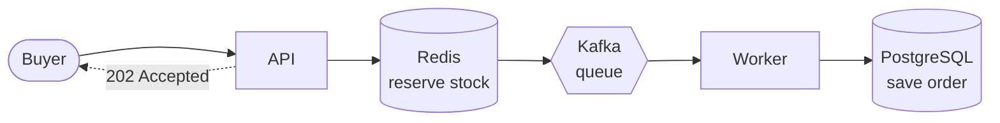
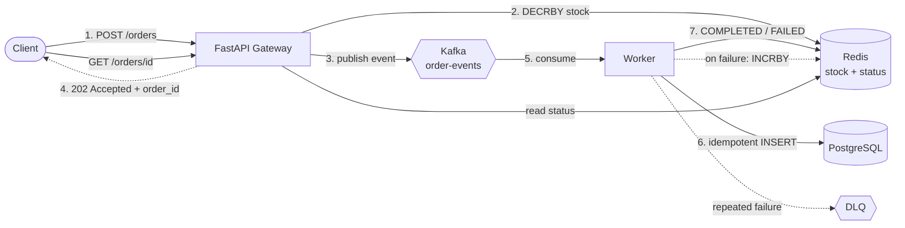
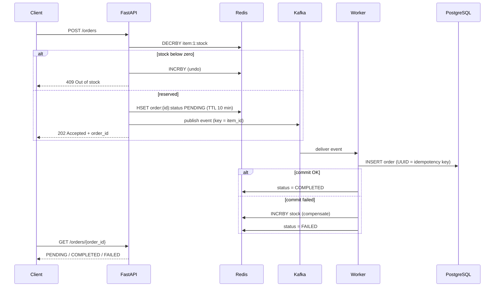

<div align="center">

# 🚀 Order Engine
### Learn backend system design by building a flash-sale system, one level at a time


**Accept orders in RAM. Save them in the background. Never oversell.**

</div>

---

## 🧭 How to Read This README

This is a **learning project**, not just a code repo. It is organised as a staircase. Every level starts with something that breaks, then shows the concept that fixes it, and why.

| Marker | Meaning |
| :---: | :--- |
| 🟢 | Beginner friendly. Start here if backend design is new to you. |
| 🟡 | Intermediate. Assumes you know what a database transaction is. |
| 🔴 | Advanced. Failure modes and trade-offs. |
| ✅ | Built and working in this repo |
| 🔜 | Designed and explained, not built yet |

**Jump to:** [30-second summary](#-the-30-second-version) · [The problem](#-the-problem) · [Level 0-5](#-the-journey) · [Final architecture](#-final-architecture-level-4) · [Concept cheat sheet](#-concept-cheat-sheet) · [Learning lab](#-learning-lab) · [Honest limitations](#-honest-limitations) · [Run it](#-run-it-locally)

---

## ⚡ The 30-Second Version

1. A buyer clicks **Buy**.
2. The API checks and reserves stock **in Redis (RAM)**. This takes about a millisecond.
3. The API drops an event on a **Kafka** queue and instantly replies **`202 Accepted`** with an order ID.
4. A **background worker** reads the event and saves the order in **PostgreSQL**.
5. If saving fails, the worker **puts the stock back** in Redis.
6. The buyer **polls** `GET /orders/{id}` to see `PENDING` ➔ `COMPLETED`.



---

## 🎯 The Problem

Imagine a shop with **1 phone left** and **10,000 people** pressing *Buy* in the same second.

| What goes wrong | Plain-English explanation | Technical name |
| :--- | :--- | :--- |
| Two people both get the last phone | Both read "stock = 1" before either updated it | **Race condition** |
| The website freezes | Everyone waits in a single line for the database | **Lock contention** |
| A crash loses orders | The server died between "paid" and "saved" | **Data loss / partial failure** |
| The same order is saved twice | A message was delivered a second time | **Duplicate processing** |

The rest of this README fixes these four problems, one at a time.

---

## 🪜 The Journey

Each level follows the same pattern: **Build ➔ It breaks ➔ Concept ➔ Why ➔ Try it.**

### 🟢 Level 0: The naive version ✅

**What we built:** `POST /orders` reads the item, checks stock, subtracts, and saves the order, all in one SQL transaction.

**It breaks when:** many buyers arrive at once. Every request fights for the same database row, so latency climbs, and without care two requests can both pass the stock check.

**Concept: ACID transaction.** The database guarantees that the steps either all happen or none do.

**Why we start here:** you cannot appreciate the fixes until you have seen the problem. This is the baseline to measure against.

> 🧪 **Try it:** fire 50 parallel requests at an item with stock 10. Count how many succeed.

---

### 🟢 Level 1: Make the database smarter ✅

**What we changed:** an index on lookup columns, and one atomic conditional update instead of read-then-write.

```sql
UPDATE items SET stock = stock - 1 WHERE id = 1 AND stock >= 1;
-- 1 row affected  -> you got it
-- 0 rows affected -> sold out
```

**Concept: atomic conditional update + B-tree index.** The check and the change happen in one indivisible step, so the race condition disappears. The index turns a full-table scan into a quick lookup.

**Why:** it is the cheapest possible fix and often enough for small shops. Do not add Kafka if an `UPDATE ... WHERE` solves your problem.

**It breaks when:** traffic grows. Correctness is solved, but every buyer still waits on the same row lock in the database.

> 🧪 **Try it:** remove the `AND stock >= 1` condition and re-run your concurrency test. Watch overselling appear.

---

### 🟡 Level 2: Stop asking the database the same question ✅

**What we changed:** `GET /items` is served from Redis, and Postgres is only hit on a miss.

**Concept: cache-aside pattern.** Check the cache. If it is missing, read the database, then store the result in the cache.

**Why:** reads are far more frequent than writes. Browsing traffic should never compete with buying traffic.

**Trade-off:** cached data can be stale. Decide how stale is acceptable (a TTL) or invalidate on writes.

> 🧪 **Try it:** change a price in the DB directly. How long until the API shows it?

---

### 🟡 Level 3: Move the stock check into RAM ✅

**What we changed:** stock lives in Redis. Each order runs `DECRBY item:1:stock 1`. If the result is below zero, the API runs `INCRBY` to undo it and rejects the order.

```python
remaining = redis.decrby(f"item:{item_id}:stock", qty)
if remaining < 0:
    redis.incrby(f"item:{item_id}:stock", qty)   # undo
    raise HTTPException(409, "Out of stock")
```

**Concept: atomic in-memory counter + compensating action.** Redis runs commands one at a time, so two `DECRBY` calls can never interleave. No locks to manage.

**Why:** a RAM operation takes microseconds. A database row lock takes much longer and queues. Rejected buyers never touch the database at all.

**It breaks when:** the API still waits for Postgres to save the order before replying. Response time is tied to disk speed.

> 🧪 **Try it:** set stock to 5, send 20 requests, and check that exactly 5 succeed and the Redis value ends at 0.

---

### 🟡 Level 4: Don't make the user wait for the disk ✅ ← *you are here*

**What we changed:**
- `POST /orders` now returns **`202 Accepted`** plus a UUID right after reserving stock.
- The order is published to the Kafka topic `order-events`.
- `worker.py` consumes events and writes to PostgreSQL.
- `GET /orders/{id}` reads a short-lived Redis Hash for the status.

**Concepts used:**

| Concept | What it is | Why we need it here |
| :--- | :--- | :--- |
| **Asynchronous processing** | Reply now, finish the work later | Response time no longer depends on DB speed |
| **Message queue (Kafka)** | A durable buffer between producer and consumer | Absorbs traffic spikes, survives worker crashes |
| **`202 Accepted`** | HTTP status for "received, not finished" | It is the honest status code for this situation |
| **Eventual consistency** | The DB catches up shortly after the reply | Trade a short delay for much higher throughput |
| **Polling** | Client asks "is it done yet?" | Simple way to learn the outcome of async work |
| **Idempotency** | Doing the same operation twice has the same effect as once | Kafka may deliver a message twice, so the UUID is the guard |
| **Saga / compensating transaction** | Undo earlier steps when a later step fails | If Postgres rejects the order, `INCRBY` returns the stock |
| **Dead-letter queue (DLQ)** | A parking place for messages that keep failing | Bad messages must not block good ones. See `dlq_inspector.py` |

**It breaks when:** one product gets nearly all the traffic (a *hot key*). That is Level 5.

> 🧪 **Try it:** stop `worker.py`, place 10 orders, then restart the worker. Do all 10 reach `COMPLETED`? That is Kafka doing its job.

---

### 🔴 Level 5: Survive a viral product 🔜

Level 4 scales across many products. Level 5 handles **one** product that everyone wants. Four upgrades, each targeting a different hotspot:

| Upgrade | Bottleneck it removes | How | Trade-off |
| :--- | :--- | :--- | :--- |
| 🪣 **Sharded stock buckets** | One Redis key under heavy load | Split `stock=1000` into `bucket:0..9`, pick a random one | A bucket may empty while others have stock, so retry another bucket |
| 🧂 **Key salting** | One Kafka partition gets all the events | Use `item:1:salt:0..7` as the key | Lose strict per-product ordering |
| 👷 **Worker pool** | One worker is the ceiling | Many workers, same `group_id` | Useful workers are capped by partition count |
| 📦 **Micro-batching** | One DB round trip per order | Insert hundreds of rows per statement | A failed batch needs batch-level compensation |

```python
# Key salting
key = f"item:{item_id}:salt:{random.randrange(8)}"
producer.send("order-events", key=key.encode(), value=payload)
```

```sql
-- Micro-batching, still idempotent
INSERT INTO orders (id, item_id, qty) VALUES (...), (...), (...)
ON CONFLICT (id) DO NOTHING;
```

> **Why ordering can be given up:** stock safety is already decided in Redis. By the time an event reaches Kafka, the order is guaranteed a unit, so the sequence of inserts into Postgres no longer matters.

---

## 🏗️ Final Architecture (Level 4)





---

## 📖 Concept Cheat Sheet

*"Where did we use it, and why?"* in one table.

| Concept | Where in this project | Why it is the right choice | Alternative |
| :--- | :--- | :--- | :--- |
| **Atomic operation** | Redis `DECRBY`, SQL `UPDATE ... WHERE stock >= n` | Check-and-change in one step removes race conditions | Application-level locks (slow, error-prone) |
| **Caching (cache-aside)** | `GET /items` via Redis | Offload read traffic from Postgres | Read replicas |
| **In-memory store** | Stock counter, order status | RAM is orders of magnitude faster than disk | Always hitting the DB |
| **Async / non-blocking I/O** | FastAPI + Kafka producer | Don't hold the user while slow work happens | Synchronous request handling |
| **Message queue / event streaming** | Kafka `order-events` | Buffer bursts, decouple API from DB, replayable | RabbitMQ, SQS, Redis Streams |
| **Partitioning** | Kafka key = `item_id` | Keeps one product's events in order, enables parallel consumers | Single partition (no parallelism) |
| **Consumer group** | `worker.py` | Share partitions across workers for horizontal scaling | One worker |
| **At-least-once delivery** | Offsets committed after processing | Never lose an order, accept possible duplicates | At-most-once (can lose data) |
| **Idempotency** | Unique order UUID in Postgres | Makes duplicate delivery harmless | Exactly-once semantics (complex) |
| **Saga / compensating transaction** | `INCRBY` on failure | There is no single transaction across Redis and Postgres, so we undo manually | Two-phase commit (heavy) |
| **Dead-letter queue** | `dlq_inspector.py` | Poison messages must not block the queue | Infinite retry |
| **Eventual consistency** | Redis says `PENDING`, DB catches up | Trades instant consistency for speed | Strong consistency (slower) |
| **TTL (expiry)** | 10-minute status keys | Self-cleaning memory | Manual cleanup jobs |
| **Connection pooling** | SQLAlchemy engine in `database.py` | Reuse DB connections instead of opening one per request. SQLAlchemy's default pool is 5 connections plus 10 overflow | New connection per query |
| **Row-level locking** | Postgres `UPDATE` | Two transactions changing *different* rows do not block each other | Table locks |
| **Horizontal scaling** | More workers / partitions (Level 5) | Add machines instead of buying a bigger one | Vertical scaling |

---

## 🎓 Learning Lab

### 📚 Mini glossary

| Term | One-line meaning |
| :--- | :--- |
| **Throughput** | How many requests are handled per second |
| **Latency** | How long one request takes |
| **Hot key** | One key receiving a disproportionate share of traffic |
| **Producer / Consumer** | The side that writes messages / the side that reads them |
| **Offset** | A consumer's bookmark in a Kafka partition |
| **Backpressure** | When a slow consumer forces the system to slow or buffer |
| **Poison message** | A message that fails every time it is processed |
| **Source of truth** | The one store whose data wins when systems disagree (here: Postgres) |

### 🧠 Think like an engineer: what if...?

Work through these before reading the answers.

<details>
<summary><b>1. The API reserves stock in Redis, then crashes before publishing to Kafka?</b></summary>

The unit is reserved but no order will ever be created. Stock is **leaked**. This is the **dual-write problem**: Redis and Kafka are two separate systems with no shared transaction. Fixes: (a) wrap the publish in try/except and `INCRBY` if it fails, (b) the **transactional outbox pattern**, or (c) a periodic **reconciliation job** that recomputes true stock from Postgres.
</details>

<details>
<summary><b>2. Redis restarts and loses its data?</b></summary>

Stock counters vanish. Redis offers persistence (RDB snapshots, AOF logs), but neither is a guarantee against losing the last moments of writes. Postgres is the source of truth, so a startup job can **rebuild** Redis stock as `DB stock minus in-flight orders`.
</details>

<details>
<summary><b>3. The worker is down for an hour?</b></summary>

Orders wait in Kafka, which retains them. Buyers see `PENDING`. When the worker returns, it catches up. If it takes longer than the status TTL (10 min), the status key expires. A client could then see "not found" for a valid order, so a fallback to the DB is worth adding.
</details>

<details>
<summary><b>4. Kafka delivers the same message twice?</b></summary>

The worker tries to insert the same UUID again. The unique constraint rejects it, the worker treats this as "already done", and commits the offset. No duplicate row.
</details>

<details>
<summary><b>5. A message fails every single time?</b></summary>

After a limited number of retries, move it to the **dead-letter queue** so the rest of the partition keeps flowing, and inspect it later (`dlq_inspector.py`).
</details>

<details>
<summary><b>6. Why not just use <code>SELECT ... FOR UPDATE</code> in Postgres?</b></summary>

It is correct, and it is the right answer for modest traffic. It serialises buyers on one row lock, so throughput is capped by how fast the DB commits. The Redis gate removes that ceiling by rejecting most losers before they reach the DB.
</details>

### ⚖️ A lens: consistency vs availability

When systems disagree or fail, you must choose what to protect. This design chooses to **keep accepting orders** (availability) and let the database **catch up later** (eventual consistency). It never trades away the guarantee that you will not sell more than you have. The status shown to a buyer can briefly lag the truth, and that is an accepted trade. (CAP theorem formally concerns network partitions in distributed data stores, so treat this as a way to think rather than a strict classification.)

### 🏋️ Exercises (easy to hard)

| # | Level | Challenge |
| :-: | :---: | :--- |
| 1 | 🟢 | Add a `GET /items/{id}/stock` endpoint that reads from Redis |
| 2 | 🟢 | Run the concurrency test with 200 buyers and record the numbers in the README |
| 3 | 🟡 | Replace `DECRBY` + `INCRBY` with a **Lua script** that only decrements if enough stock remains, so the value never goes negative |
| 4 | 🟡 | Add retry with exponential backoff to the worker before sending to the DLQ |
| 5 | 🟡 | Make `GET /orders/{id}` fall back to Postgres when the Redis key has expired |
| 6 | 🔴 | Implement key salting and measure per-partition load before and after |
| 7 | 🔴 | Write the reconciliation job from question 1 |
| 8 | 🔴 | Implement micro-batching with `ON CONFLICT DO NOTHING` and batch-level compensation |

### 📕 Where to go deeper

- *Designing Data-Intensive Applications* by Martin Kleppmann (the chapters on replication, partitioning, and stream processing map directly onto this project)
- The official Apache Kafka documentation (consumer groups, delivery semantics)
- The official Redis documentation (atomic commands, persistence, Lua scripting)
- The PostgreSQL documentation on transaction isolation and explicit locking

---

## ⚠️ Honest Limitations

A good engineer states what the system does **not** do.

| Limitation | Impact | How to address it |
| :--- | :--- | :--- |
| Redis and Kafka are not updated atomically (dual write) | A crash between them can leak one unit of stock | Outbox pattern or reconciliation job |
| Redis is not the source of truth | After a Redis loss, counters must be rebuilt from Postgres | Startup rebuild job, AOF persistence |
| Benchmark is small (50 concurrent buyers) | Proves correctness, not scale | Scale the test, record real numbers |
| Single partition ordering by `item_id` | One hot product caps throughput | Level 5 key salting |
| Status keys expire after 10 minutes | Late pollers see "not found" | Fall back to the DB |
| Throughput figures in the roadmap are design targets | Not measured on this repo | Measure and publish your own |

---

## ▶️ Run It Locally

**Prerequisites:** Python 3.12, Docker.

```bash
git clone https://github.com/Knowledgeisfun/order_engine.git
cd order_engine

# 1. Start infrastructure (see docker-compose.yml for the services)
docker compose up -d

# 2. Install dependencies
python -m venv venv && source venv/bin/activate
pip install fastapi uvicorn redis kafka-python sqlalchemy psycopg2-binary httpx

# 3. Create tables and seed data
python init_db.py
python seed_db.py
```

Then, in separate terminals:

```bash
uvicorn main:app --reload        # API
python worker.py                 # background worker
python test_concurrency.py       # load test
```

Useful extras: `python reset_db.py` wipes the database, and `python dlq_inspector.py` inspects failed messages.

### 📂 Project map

| File | Role |
| :--- | :--- |
| `main.py` | FastAPI app: `POST /orders`, `GET /orders/{id}`, `GET /items` |
| `kafka_producer.py` | Publishes order events to Kafka |
| `worker.py` | Kafka consumer: idempotent writes to Postgres, compensation on failure |
| `dlq_inspector.py` | Inspect messages that landed in the dead-letter queue |
| `models.py` | SQLAlchemy table definitions |
| `schemas.py` | Pydantic request/response models |
| `database.py` | Database engine and session setup |
| `init_db.py` / `reset_db.py` / `seed_db.py` | Create, wipe, and seed the database |
| `test_concurrency.py` | Async burst test (asyncio + httpx) |
| `docker-compose.yml` | Local infrastructure |

---

## 🧪 Benchmark

`test_concurrency.py` sends a concurrent burst of buyers, then checks stock integrity and polls each order.

**Setup:** one Windows laptop, Redis and Kafka in Docker, one `uvicorn` process, one worker.

**Correctness (50 concurrent buyers)**

| Check | Result |
| :--- | :---: |
| Requests accepted (`202`) | 50 / 50 |
| Overselling | 0 |
| Status readable right after the burst (`PENDING`, or already `COMPLETED` if the worker was fast) | 3 / 3 sampled |
| Orders reaching `COMPLETED` in Postgres | 50 / 50 |

**Latency: `POST /orders` sent one at a time (50 requests after warm-up)**

| | Before | After |
| :--- | :---: | :---: |
| Median | 10.5 ms | 7.8 ms |
| p95 | 18.1 ms | 14.1 ms |

Changes between the two runs: `localhost` replaced by `127.0.0.1`, console prints removed from the hot path, and `hset` + `expire` pipelined into one Redis round trip.

**Under a 50-request burst (all 50 sent at the same instant)**

| | Before changes (1 run) | After changes (3 runs) |
| :--- | :---: | :---: |
| Time for all 50 `POST /orders` to return | 1,241 ms | median 1,048 ms (range 884 to 1,211) |
| Average latency per request | 390 ms | median 281 ms (range 276 to 323) |

The burst average mostly reflects requests queueing behind each other in one process, so it is not the cost of a single order. Runs vary by roughly 15 to 20% from one to the next, so treat differences smaller than that as noise.

**Where the time goes**

| Measurement | Result |
| :--- | :---: |
| Redis inside its own container (`redis-cli --latency`) | 0.22 ms avg |
| Python `PING` from the host to Redis | 1.94 ms |

Redis itself is fast. The extra round-trip cost is most likely the Windows-to-Docker network path. Each order makes 3 Redis round trips, so most of the request time is network waiting. A single Lua script would cut that to one round trip.

> 📌 Measured on one local machine. The throughput numbers in the level descriptions are design goals, not results from this repo. End-to-end time until `COMPLETED` was only checked with a fixed 2-second wait.

---

## 🗺️ Roadmap

- [x] Level 0: Direct DB writes
- [x] Level 1: Atomic conditional update and indexing
- [x] Level 2: Redis cache-aside reads
- [x] Level 3: Redis atomic stock gate with rollback
- [x] Level 4: Kafka, `202 Accepted`, background worker, status polling, DLQ
- [x] Roll back stock and mark the order `FAILED` when Kafka delivery fails (producer errback)
- [ ] Cover the remaining gap: API crash between the Redis reservation and the Kafka send
- [ ] Redis stock rebuild / reconciliation job
- [ ] Level 5: sharded buckets, key salting, worker pool, micro-batching
- [ ] Larger benchmark (1,000+ buyers) with published results

---

## 🧰 Tech Stack

| Layer | Tool |
| :--- | :--- |
| API | FastAPI, Uvicorn (Python 3.12) |
| Hot state | Redis |
| Event broker | Apache Kafka (`kafka-python`) |
| Database | PostgreSQL (SQLAlchemy, Psycopg2) |
| Infrastructure | Docker Compose |
| Testing | asyncio, HTTPX |

<div align="center">

**Each level breaks something. Each fix teaches something.** ⚡

</div>
